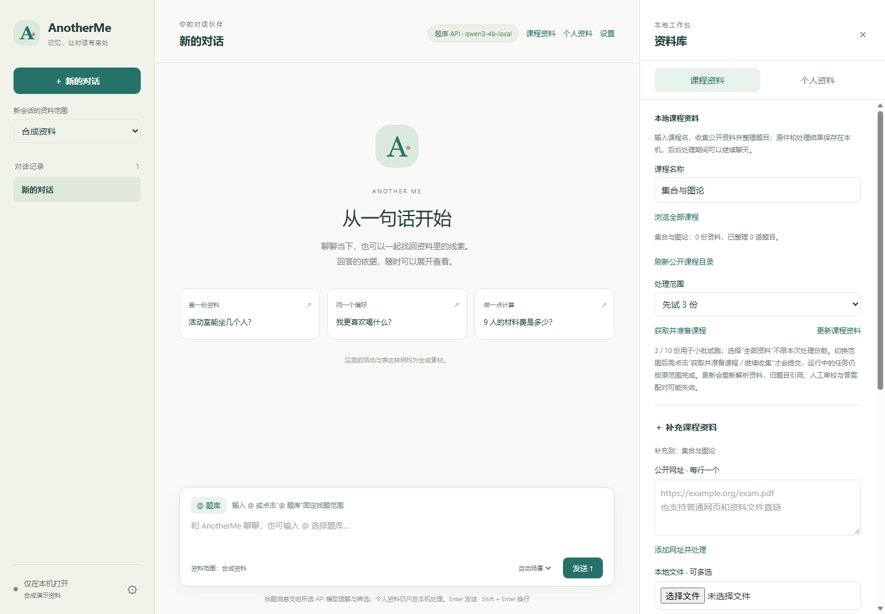

# AnotherMe

基于 **LangGraph 单 Agent** 的本地中文对话与课程资料助手。输入课程名、导入文件或添加公开网址，即可收集资料、查看处理进度、按问题检索题目，并用自己配置的模型完成第二轮筛选。原始文件、题目出处、处理结果与会话保存在本机。

**[下载 Windows 便携体验版](https://github.com/Octo403/AnotherMe/releases/download/v0.1.0-preview.3/AnotherMe-Portable-Windows-x64.zip)** · [版本说明](https://github.com/Octo403/AnotherMe/releases/tag/v0.1.0-preview.3) · [详细使用与构建说明](docs/PORTABLE.md)

已下载 preview.1 / preview.2：可用 [升级补丁](https://github.com/Octo403/AnotherMe/releases/download/v0.1.0-preview.3/AnotherMe-preview1-2-to-preview3-patch.zip)，停止服务及后台任务后复制到原目录覆盖，保留 `user-data`。本次补齐个人资料的本机模型设置，改善密钥保存状态与安装后的 CLI 检测。



## 下载后怎么用

面向 **Windows 10 / 11 x64**，ZIP 约 **710 MB**，自带 Python、应用依赖和 LibreOffice 文档转换器。无需另装 Python、Word、Docker 或 Codex CLI。当前为预览版，已在开发者 Windows 本机验证，尚未覆盖干净虚拟机和其他系统。

1. 从上面的下载链接获取 `AnotherMe-Portable-Windows-x64.zip`，**完整解压**到可写目录。
2. 双击 `Start.bat`，浏览器自动打开本机页面；重复双击会复用当前副本的服务。
3. 首次引导中填写自己的模型 API 地址、Key 和型号，测试连接后保存。也可以选择“先用本地筛选”，体验导入和检索。
4. 打开“课程资料”，输入课程名查找公开资料，或点击“＋ 补充课程资料”上传文件、添加公开网址；新课程也可以自行创建。
5. 查看收集和逐文件处理进度，在聊天中用 `@课程名` 指定课程，再输入如“找几道矩阵秩的计算题”。配置模型后，系统先本地召回候选，再根据本次提问进行第二轮筛选。
6. 使用结束后双击 `Stop.bat` 停止当前副本的界面。备份、更新或移动数据前，请等待后台处理完成。

包内 `示例资料/示例课程-期末试题.md` 是原创虚构试题，可直接上传体验。**GitHub 的 “Code → Download ZIP” 是源码，不含运行环境；普通用户请选择上面的便携版。**

## 当前能做什么

| 功能 | 说明 |
| --- | --- |
| 课程查找与收集 | 搜索、滚动浏览 FDU-Sharing 课程目录；后台收集、显示进度、继续收集或重试失败文件 |
| 自己补充资料 | 上传 PDF、DOC、DOCX、MD、TXT、HTML、ZIP，或添加公开文件/网页网址；支持重复提示、替换与逐文件重试 |
| 题目整理 | 保留原件和出处；MD / TXT / HTML 显示标准文字题目，PDF / Word 在定位成功时提供原题预览 |
| 按问题找题 | 本地候选检索 → 模型理解与筛选 → 带出处的题目；支持课程限定与参考题追问 |
| 独立设置 | 模型配置与资料查找分开；支持 API 型号目录、手动型号、连接测试和 Windows 加密保存 Key |
| 本地持久化 | SQLite 保存题库、处理任务、会话和偏好，重启后继续使用 |
| 个人对话实验 | 独立的五节点 LangGraph 流程，支持来源引用、历史上下文、受限技能与自省；默认使用虚构资料 |

模型 API 需要联网及你自己的服务额度。题库模型设置用于找题意图理解与第二轮筛选；个人对话模型在“设置 → 个人资料回答模式”单独填写本机地址、型号，测试并保存后即可启用，便携版不附带模型权重。已安装并登录 Codex CLI 的用户还可选择 ChatGPT 登录方式，它不是便携版的必需项。官方免 CLI 浏览器登录尚未接入，说明见 [便携版文档](docs/PORTABLE.md)。

DOC / DOCX 由包内 LibreOffice 转换，字体、公式、分页可能与 Word 不同；未能确认题目边界时保留原文件入口。扫描件、复杂公式和答案配对可能需要人工审校。当前便携包未包含 7-Zip，RAR / 7z 需要另行安装转换工具。详细限制见 [题库说明](docs/QUESTION_BANK.md)。

## 资料存在哪里

便携版首次启动后，资料保存在**解压目录里的 `user-data/`**：

```text
AnotherMe-Windows-x64/
├─ Start.bat
├─ Stop.bat
├─ 示例资料/
├─ runtime/                  Python 与应用依赖
├─ tools/libreoffice/        Word 文档转换器
└─ user-data/
   ├─ question_bank/         原始文件、处理结果、题库数据库
   ├─ application/           会话、偏好、独立合成资料
   └─ desktop.json           当前副本的服务信息
```

停止服务且后台任务完成后，复制整个 `user-data/` 即可备份。升级时解压新版本，再复制旧 `user-data/`；不要用空目录覆盖旧资料。加密 Key 与当前 Windows 账户绑定，换电脑或账户后需要重新填写。源码运行时，题库默认在 `data/question_bank/`，合成界面数据在 `data/runtime/ui-synthetic/`。

资料默认本地保存。使用远程模型时，本次问题与候选题目会发往配置的服务；选择 MinerU 在线解析时，所选 PDF 会上传至该服务。请仅为允许发送的资料启用这些功能。目前未实现坚果云同步、多人共享或 Zotero 式文件夹管理。

## 从源码运行

需要 Git、Python 3.11+；以下使用 [uv](https://docs.astral.sh/uv/) 管理 Python 3.13 环境：

```powershell
git clone https://github.com/Octo403/AnotherMe.git
cd AnotherMe
uv venv .venv --python 3.13
uv pip install --python .venv\Scripts\python.exe -e ".[dev,privacy,question-bank]"
.venv\Scripts\aitown.exe --mode demo ui
```

打开 `http://127.0.0.1:8501`。源码版处理 Word 需要本机 LibreOffice 或 Microsoft Word；便携版已包含 LibreOffice。题库 API 可在网页“设置”中配置。个人对话使用真实模型时，复制 `.env.example` 为 `.env`，填写自己的 `LLM_BASE_URL`、`LLM_API_KEY` 和 `LLM_MODEL`，然后运行 `aitown --mode live ui`。不要提交 `.env`。

命令行也可使用：

```powershell
.venv\Scripts\aitown.exe --mode demo ask "读书交流会活动室容纳多少人？"
.venv\Scripts\aitown.exe --mode demo chat --session reading
.venv\Scripts\aitown.exe --mode demo graph
.venv\Scripts\python.exe -m pytest -q
```

默认示例人物、经历和试题均为虚构。运行不会自动扫描或导入你的微信资料。Python 包名与命令名保留为 `aitown`。

## 开发与验证

主对话保持一个 `AnotherMeAgent`：`context → intent → rag / skill → reflect`。耗时的课程收集与资料处理由独立后台任务完成，主 Agent 通过只读题库技能检索结果。来源不足时明确保留缺失，不把生成内容写成个人经历。

- [便携版使用、构建与实测范围](docs/PORTABLE.md)
- [课程资料与题库](docs/QUESTION_BANK.md)
- [界面使用](docs/UI.md) · [架构](docs/ARCHITECTURE.md) · [检索](docs/RETRIEVAL.md) · [技能](docs/SKILLS.md)
- [便携版实测摘要：14 项流程、8 项浏览器检查](docs/verification/portable-20261009.json)
- [本次发布验证：独立源码副本 335 项测试通过](docs/verification/publication-20261011.md)
- [发行包第三方组件与许可说明](docs/PORTABLE_NOTICES.txt)

发布源码仅包含程序、测试、文档和明确列出的虚构示例。`.gitignore` 默认排除其余 `data/`、模型权重、微信导出、个人研究记录、`.env`、虚拟环境、构建目录与便携包；可执行体验包通过 GitHub Releases 提供。公开课程资料来自上游项目，下载后仍需遵守原资料的使用要求，本仓库不打包分发课程原件。
