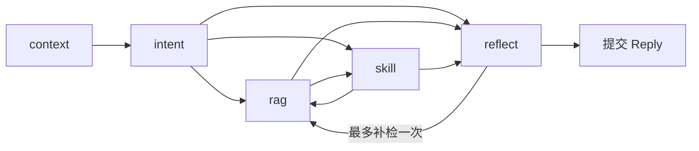

# T9：五节点调度与证据自省

T9 将单 Agent 的五个节点拆为 `src/aitown/nodes/` 内部模块，`graph.py` 保留编排、运行入口和检查点恢复。CLI 继续使用同一个 AnotherMeAgent；多次模型调用属于同一轮任务。

## 执行计划与结构

| 模块 | 职责 | 可检查的输出 |
|---|---|---|
| context | 清空新轮次结果，读取允许的历史、摘要、风格和画像 | 历史来源 ID、有效场景、错误 |
| intent / references | 保留原问题，解析当前会话指代、日期与结构化计划 | Decision、ReferenceResolution、候选调用与澄清原因 |
| rag | 按用途、主体、显式关系范围和时间检索 | Citation、过滤参数、检索状态 |
| skill | 校验目录、参数及依赖证据，执行真实技能 | SkillResult、实际调用与执行记录 |
| reflect / checks | 生成初稿、确定性检查、模型自省、有限补检及提交回复 | 初稿、两阶段检查、修正、最终原因、请求耗时和 tokens |

`Decision.plan` 只能是空计划、rag、skill、rag→skill 或 skill→rag，同一计划不能重复节点。`plan_cursor` 推进步骤；需要澄清时直接进入 reflect。自省可以返回 rag 一次，补检后进入 reflect，不回到 skill。条件边使用 LangGraph 的 [add_conditional_edges](https://reference.langchain.com/python/langgraph/graph/state/StateGraph/add_conditional_edges)。



图中 rag↔skill 表示两种计划，不能在同一轮任意循环。初次检索无命中时，依赖资料的工具步骤标为 skipped，不猜测参数。费用案例从实际资料取得每人 15 元，结合用户输入 12 人调用计算器得到 180；不会沿用模型在检索前猜测的单价。

`Decision` 有原问题、完整查询、意图、候选调用、经过校验的调用、计划、置信描述、澄清问题、用途、主体与时间条件。`Reply` 另包含来源、实际工具状态、路径、原始初稿、自省记录、纠错轮数、错误分类、模型请求和终止原因。置信描述是调度判断，不是事实真实性的概率。每轮最多三个技能调用；真实调用名只来自结构化字段，不从生成文本中猜测。

## 指代、主体与时间

指代解析只从当前会话的用户原文提取候选，保存命中的 `turn_id` 和原文依据，不把助手猜测作为人物来源。当前输入明确指定对象时使用该对象；历史只有 hx 时“他”可补为 hx，出现 hx 与 ql 后要求澄清。没有候选也要求补充。“那件事”“之前说的”“那里”等使用命名活动、地点话题或明确动作，不拼接全部历史，也不重放历史计算指令。

人物代称当前支持短字母代称和部分中文姓名规则；事件解析也有范围限制。多个话题不自动猜最近一个。长期历史原文仍可查询，自动指代使用本轮加载的短期窗口；本实现不是通用语言学指代模型。

本人查询使用 `subject=self`，明确他人查询使用来源中实际主体，例如 `other:hx`。个人检索仍要求显式 `--scope`，未知关系不自动合并。用户明确询问本人偏好或经历时先检索；模型不知道答案不能成为要求重新提供事实的理由。没有有效个人证据时直接说明不知道，不调用生成模型补造经历。

日期从当前输入和轮次开始时间推导，时区 UTC+8；目前支持上个月、去年、昨天、今天及“截至 YYYY-MM-DD”。相对月份按日历区间计算，结束时间包含最后一秒；非法日期要求澄清。发生时间、来源记录时间、事实有效区间分别保留；检索过滤与来源有效性检查先执行，模型自省再核对文本中的时间含义。其他日期表达留待扩展。

## 初稿、校验与修正

初稿使用当前允许的事实、成功工具结果、短期历史、最多六条画像和三条风格样例。样例仅指导表达，不作为个人经历证据；虚构会话方案保留为任务参数。`CONTEXT_MAX_CHARS` 默认 6500，限制传给适配器的任务消息总字符数；先省略较早完整历史对，不截断本轮问题或证据中的否定、日期。必要消息仍超限时返回 context_length。适配器另附 JSON Schema，修复时最多附 2000 字符错误输出；字符限制不等同供应商 token 上限，后者仍由实际接口反馈。

`Claim.subject` 有四个角色：general（文档和工具事实）、self（本人）、task（会话参数）、other（他人）。other 必须提供与资料一致的 `subject_id`。`source_refs` 只能使用本轮文档/个人资料的完整 ref，例如 `document:1:0#0`；工具在 `claims.tool_refs` 用整数编号引用。JSON Schema 模式按本轮有效来源设置引用与主体 ID 枚举，没有文档时引用数组必须为空；运行后仍校验内容，不依赖供应商声明。工具名和活动名不能冒充人物主体，`calculator:0` 也不能冒充文档引用。

确定性检查包括来源存在、工具编号及成功状态、个人主体、具体经历对象、数字依据、否定丢失、遗漏计算结果和声明未回答部分。之后真实模型逐条核对事实、主体、发生/记录时间、工具结果及原问题覆盖，返回完整修正后的 AnswerPayload。仅写“已修正”而保留原错误无法通过最终检查。模型可以要求一次补检，仍缺依据或最终检查失败时返回不足说明或明确标注的原文/工具摘要。

`Reply.reviews` 保留每轮初稿、确定性问题、模型修正及最终检查；`correction_count` 是发生修正的自省轮数，范围 0—2，不是问题条数。`supplemental_count` 范围 0—1。没有缺口的普通轮次通常三次模型请求；补检增加两次生成/自省，证据后的工具规划可能再增加一次。每次结构化调用最多修复一次 JSON，因此实际请求以 `model_calls` 为准。HTTP 失败不做 JSON 重试。

典型 `stop_reason` 有 answered、clarification、no_evidence、model_failed、review_failed、validation_failed、evidence_insufficient、retrieval_failed 和 skill_failed。工具成功不能替代最终回答通过校验；资料在生成期间更新或删除时，旧正文和旧草稿从本轮返回结果移除，补检使用当前资料。

## 服务能力与失败恢复

模型适配器支持配置 `LLM_RESPONSE_FORMAT=json_schema/json_object/plain_json`，都需要 Pydantic 校验。`provider-test` 用合成内容测量聊天、结构化输出、强制原生工具调用、embedding、错误请求和鉴权错误；探测工具不实际执行。原生工具探测成功与业务图实际使用方式分别报告：当前业务采用 `validated_json_plan`。

本地 Qwen3-4B / llama.cpp b11384 实测支持聊天、JSON Schema 及强制原生工具调用；embedding 返回 HTTP 501，错误请求 400，错误鉴权 401。最初 JSON object 模式曾复述 Schema，有限修复仍失败；切换已实测的 JSON Schema 模式并明确要求数据实例后恢复。服务能力记录保留成功与失败，不由兼容接口名称推定全部能力。服务实现说明见官方 [llama.cpp server](https://github.com/ggml-org/llama.cpp/blob/master/tools/server/README.md)，本机能力以测量记录为准。个人语义检索继续使用 T7 的本地 BGE，与 Qwen embedding 不相关。

错误区分 model、structured、database、retrieval、skill、checkpoint、reference，包含阶段及可用 HTTP 状态码，不打印服务原始错误正文、密钥或校验输入。新轮次清空旧错误及工具结果。数据库或检查点失败后可修复原因再 `resume`；T8 的事务、请求主键和唯一约束继续防止重复写入。恢复刷新只读证据，保留已提交工具结果；补检和回答失败不重复已成功写入。T10 纠正已实现本地 SQLite 同事务恢复；外部写入仍需目标系统的幂等和恢复能力。

```powershell
.venv\Scripts\aitown.exe --mode live provider-test --output data/private/t9/provider.json
.venv\Scripts\aitown.exe --mode live ask "查询读书交流会每人费用，并计算12人总费用" --session fee
.venv\Scripts\aitown.exe --mode live ask "先计算6*7，再查询图书馆活动室容量" --session combo
.venv\Scripts\python.exe scripts/verify_pipeline.py
.venv\Scripts\python.exe scripts/verify_context.py --output data/private/t9/recovery --skip-live
.venv\Scripts\python.exe -m pytest -q -p no:cacheprovider --basetemp .tmp/pytest-pipeline
```

测量脚本使用独立合成库，不修改正式个人资料。合成测量采用 TF-IDF；T7 BGE/精排测量另见 [RETRIEVAL.md](RETRIEVAL.md)。风格来源约束延续 T6，原来的本人盲评仍然效果不理想，本轮不声称主观相似度改善。

## 实测记录

2026-10-06 完成 T9.1—T9.9，全部 **122 项测试通过**。新增测试覆盖有限 JSON 修复、鉴权错误、未知技能不执行、来源指代与歧义、时间过滤、两种组合顺序、错误引用/数字/个人对象、成功写入后的数据库与检查点失败恢复、最多一次补检、资料变更及下一轮清空。原有恢复约束保留。

完整真实模型记录：`../data/private/t9/verification/run-20261006-193430/report.json`（本地记录，不随源码发布）、`../data/private/t9/verification/run-20261006-193430/responses.json`（本地记录，不随源码发布）；六轮记录在同目录 `live_conversation.json`。17 项结果检查均通过，且八个正常案例都以 answered 结束，最终自省检查为空。

| 实际执行 | 结果 |
|---|---|
| 闲聊、文档、计算、事件拆分 | 正常生成；容量 7、计算 42、事件两项；无未知或失败技能执行 |
| rag→skill / skill→rag | 费用 15×12=180；另一顺序同时返回 42 和容量 7 |
| 未知月球经历 | 先查个人资料，再以 no_evidence 结束；不调用初稿或自省 |
| 明确纠正和他人主体 | 回答不喜欢咖啡、喜欢茶，引用新事实；hx 杭州经历仅引用 other:hx |
| 单个与多个指代 | 单个 hx 保留用户来源和改写依据；hx/ql 同时存在时澄清 |
| 六轮及重建 Agent | 第五轮返回名称、修改后的 10 人与时间；第六轮仍保留参数，另一会话空历史 |
| 注入错误初稿 | 脚本注入 999 人、本人月球经历及不存在的引用；确定性检查发现问题，真实模型自省改为容量 7，最终检查通过 |
| 模型事实写回 | 合成事实数仍为脚本预置的 3，模型输出未新增事实 |

12 份回复合计 30 次实际模型请求，37,776 input tokens、2,795 output tokens。测量约 43.60 秒，包含 provider 探测和上述回复流程；请求/token 总数不含独立六轮及 provider 探测。最终这一组无需补检；一次补检及再次缺证终止由执行真实 SQL 的受控模型测试验证，不能称为模型自主写入测量。

三个独立进程崩溃场景在 T9 图上重跑通过，约 16.64 秒：`../data/private/t9/recovery/run-20261006-192648/report.json`（本地记录，不随源码发布）。分别在写入事务内、写入提交后但技能检查点未保存、历史提交后但生成检查点未保存时真实 `os._exit`；恢复后的计数、工具记录、历史均为 1，最后一类恢复不重新生成。计划由测试模型控制，SQL、进程退出及恢复真实执行。

正式风格配置以显式 c0067 范围、独立运行库测试，加载 3 条画像及 3 条样例，真实初稿和自省均通过：`../data/private/t9/style/run-20261006-194030/report.json`（本地记录，不随源码发布）。测量发现每条画像携带 169 个来源 ID，将本地 4096-token 上下文挤满并返回 400；提示改传 trait/style ID 与形式描述，完整来源保留在资料库、状态及 Reply.profile_evidence，来源验证继续执行。该项只证明接入正常，不构成新的本人风格评分。

失败记录保留：`run-20261006-000540` 有主体/引用与不必要澄清问题；`run-20261006-192629` 为服务停止导致的连接失败；`run-20261006-193053` 暴露偏好句对象提取和引用问题。另保留风格空范围及超上下文记录。不能将失败后的原文回退记为模型回答成功。

CLI 另实际验证损坏的应用库和检查点文件，分别输出 database/checkpoint 错误并退出 1；正式库只读检查仍为版本 3、外键错误 0，1,830 条来源、114 条分类记忆、252 组风格、13 条画像、1 条事实、0 条独立用户来源：`../data/private/t9/cli-errors/report.json`（本地记录，不随源码发布）。

这些是 T9 完成时的有限合成案例与故障恢复测量，未估计复杂长会话、真实检索或自省的总体准确率。日期/指代规则有上述范围，外部 provider 未验证，小模型仍可能错误理解任务或请求不必要补检。T10 已接业务技能，T11 再扩大真实场景评测；原 T6 本人盲评保持不变。

2026-10-06 接入 T10 后又复测：`data/private/t10/t9-regression/run-20261006-203053/` 的 17 项检查均通过，六轮重启没有校验警告，八个正常案例最终检查通过；12 份回复共 30 次模型请求，约 50.26 秒（成本范围沿用原脚本定义，不含六轮和能力探测请求）。中间复测发现普通事实查询被安排空技能步骤，现已移除没有具体调用且未请求功能的多余步骤；能力目录扩大后的无效模型候选仍如实记录，不能把正常回退称作所有规划均正确。完整质量核查见 `TASK_QUALITY.md`（仅本机研究记录，不随源码发布），业务技能见 [SKILLS.md](SKILLS.md)。
